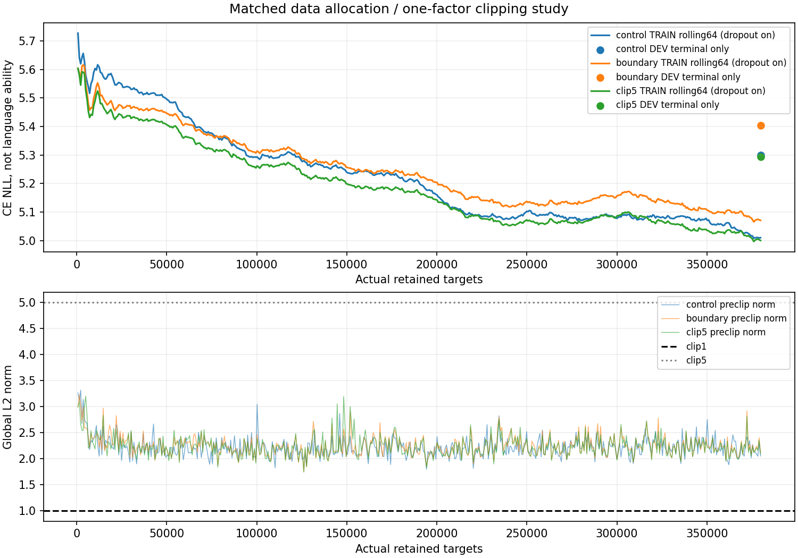
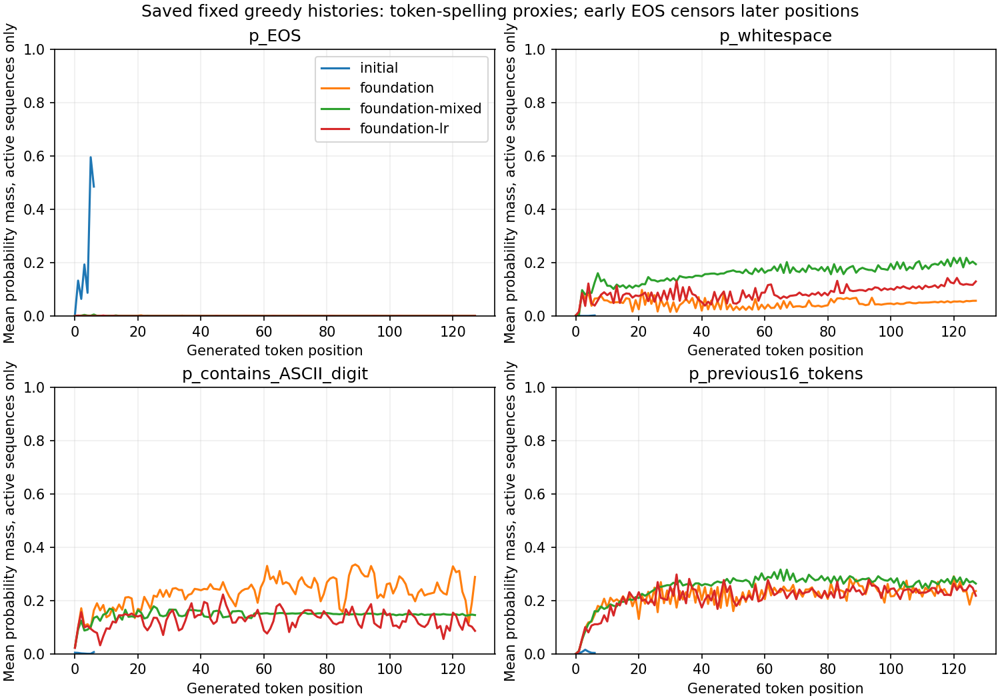

# 原文境界・自由生成崩壊・clippingの比較結果

## 結論

自然な日本語の全文生成・内容応答は未達。正式採用/公開置換はNo-Go。独立した日本語母語話者評価なし。旧R25採用/R46比較、17/13/9厳格ゲート・Pareto・反復上限を変更していない。新しい学習済み外部モデル/Tokenizer/回答API、有料資源、サブエージェント、封印TESTは使用していない。公開モデル/サイト変更・マージなし。

## なぜNLLが下がっても崩れるか

PR101の同じ固定checkpoint6個を追加学習せず測定した。原文TRAINの実EOS教師は**312/1,111,459（0.0281%）**、DEVは**2/42,125（0.00475%）**。後者はわずか2終端で、広い一般化の推定には弱い。元の窓切断箇所にはEOSを挿入していない。文末の句点と文章/文書/発話の終了は別物である。

旧LR比較モデルの、正解履歴での真の原文終端の平均EOS確率はTRAIN1.28%/DEV0.883%。初期では94.9%/94.3%だった。原文形式で終端を予測する挙動の退行は実測できる。しかし、人間会話を混ぜた旧条件でも自由原文EOS0/24、QA保持条件は正解終端でEOS確率が上がっても自由生成が終わらない。EOS頻度だけの単独原因とは断定しない。

ここで参照する旧モデルはPR101の1.11M追加学習済みで、本比較の379,767targetsとは学習量が異なる。両研究を単一要因比較とは呼ばない。

同じtoken境界・同じ正解suffixに対して、旧LRモデルの最初8位置（24×8=192位置）の参照NLLは**正解履歴4.70、自己生成履歴7.17**。正解tokenがtop1となる率は約19.3%/3.65%。正解文は唯一の有効な続きではないため、この一致率を意味理解の成績にしない。絶対NLLも高く、「正解履歴なら十分理解できるがdecodeだけ壊れている」とは言えない。予測能力の不足と自己履歴での誤差増幅が併存する。

反復4gramの初回完成は中央値8token目。これは機械的な指標であり、意味崩壊の厳密な初回位置ではない。数十token後だけの問題ではなく、初期から起きる。旧LRモデルの前16生成token集合へ置く平均確率は最初8位置7.2%→32位置以降23.1%。数字を含むtokenの確率は9.3%→13.3%、空白は5.1%→9.2%。token表記によるproxyであり、全文読解の代替ではない。早期EOSによる後半位置の観測打切りを図/CSVで明示した。

保存した全自己生成履歴をfull causal forwardで再採点した旧6状態のargmax差は0。モデルは256入力では次tokenを予測でき、257入力は位置埋め込み範囲外として明示的に失敗する。主評価はその前に止まる予算なので、context上限到達や暗黙rollingは今回の早期ループを説明しない。長い会話に256が短いという別の問題は残る。

原文/人間会話/QAを分けた頻度と確率は `diagnostic/` / `forms/`。QAは同じ既存人手32DEVのprefix/正解span/保存済みgreedy出力で照合した。旧初期モデルはQA正解末端EOS確率0.037%なのに自由終了32/32（相槌）。旧QA単独は正解末端40.4%でも自由終了5/32。終わること・正解末端の確率・適切な回答は別である。

## BPE境界と評価

旧文字prefix24のうち4件の再分割差をPR101に保持し、本比較の主24件は固定された元全文BPE境界版。20の変更なしprefixの出力一致は既存証拠を再利用。初期の厳格全文成立は2/24、境界版の例えてしまうんですねは文体/意味の曖昧さとして別記し、保守的な成功数を後から引き上げない。

共通原文DEVはJaQuADが中心で、Wiki短段落への適合を測るには偏りがある。追加の段落DEVは3componentと少なく、料理など新しい全分野を代表しない。この制約を評価の事後変更で取り除いたことにしない。

追加の完結段落DEVは**旧DEVの3component**に独立段落の入力契約を付けたもの。新しい独立TESTでも24独立文書でもない。未知の作者による盲検評価は未確保。主24は12component由来の関連した2prefixずつである。

## 変更したデータ

同一初期3470 model/Adam/RNG、独自11,225,280パラメータ/8層/320dim、BPE3997/context256、全causal CE、LR3e-5、clip1、FP32/CPU2。固定terminalで、DEV best選択なし。

A: 3個の既存JaQuAD cut窓＋共通の元RealPersona窓。B: 1共通JaQuAD窓＋2個の自然に完結した原段落＋同じRealPersona窓。**全slotの入力長/PAD/教師位置・各条件の379,767targets/512更新を一致**させた。A/BでlossやLR、モデル、Tokenizerを同時変更していない。

Bの原段落は**1,024件、123,767本文tokens、400components**。Wikibooks35,938/Voyage87,829tokens。最大1component64段落。共有RPは512窓/502会話。旧PR101採用部分集合の再構成であり、新しい独立原文を取得した量は0。比較間で同じ原文を使っても独立量を加算しない。A/Bの原本文教師位置は363,050/362,026で、差1,024は追加の終端教師に対応する。

固定23標本＋追加16標本を実際に読み、欠落した参照、翻訳の崩れ、誤った強い断定、時点依存の運行/安全助言等を隔離した。全部の原文を個別に審査済みとはしない。元の出典/revision/URLとCC BY-SA条件、原文抽出SHA、PR101の執筆者不確実性を維持する。全人間執筆/全事実の保証や正式公開モデル用の全面承認ではない。既知の原典component/既存splitは維持し、全寄稿者/意味family独立は未証明。

新しいEOSは**元の処理済み段落全体**で、句点・閉じた括弧・参照依存等を検査して独立タスクとした末端のみ。JaQuADへの新EOSと任意の256token境界EOSは0。BOS/EOSは独立段落タスクの境界で、元pageの先頭/末尾という主張ではない。A/BのEOSは8,172/9,196（うち共通RP8,172）。新しい段落EOS1,024に伴いgenre/BOSの分布も変わるため、純粋なEOSだけの因果と呼ばない。decoderの旧stopラベルと各資料の終端意味は `STOP_SEMANTICS.json` に区別した。

## 同じ正解末端でのEOS予測

| 条件 | 旧原文DEV末端2件 | 新段落TRAIN固定32 | 新段落DEV3件 | DEVでEOS最尤 | 人間会話DEV末端 | 人手QA32末端 |
|---|---:|---:|---:|---:|---:|---:|
| control | 0.7073 | 0.5440 | 0.6979 | 3/3 | 0.6236 | 0.000243 |
| boundary | 0.2897 | 0.2488 | 0.2560 | 2/3 | 0.6155 | 0.000274 |
| clip5 | 0.3018 | 0.2496 | 0.2526 | 2/3 | 0.5996 | 0.000259 |

数値は正解履歴の末端EOS確率の平均。B/Cは新段落DEVの正解履歴なら2/3でEOSが最尤でも、自由生成では0/3終了した。正しい末端へ至る本文を自己生成できない問題が残る。source/終端数が違う列を同じ母集団の頻度とは解釈しない。

## 実行数と中断復旧

| 条件 | 実call | 保持更新 | 2→4照合 | 中断再計算 | 保持targets | 保存累積秒 |
|---|---:|---:|---:|---:|---:|---:|
| control | 514 | 512 | 2 | 0 | 379,767 | 584.6 |
| boundary | 594 | 512 | 2 | 80 | 379,767 | 460.8 |
| clip5 | 514 | 512 | 2 | 0 | 379,767 | 471.4 |

実call合計**1622**、保持**1536**、再計算/照合**86**、保持targets**1,139,301**。同一モデルが全条件の合計targetsを累積学習したわけではない。追加QA学習は0。

Bは208更新完了後にプロセス消失。128更新checkpointから129–208を再計算し、**80件すべてのloss/勾配/教師数traceがbit一致**した。元の208状態自体は未保存なので、失われた状態の直接hash照合をしたとは主張しない。別途、各armの実更新2→4は別プロセスで全model/Adam/RNG/trace一致を確認。Bの実callは594=保持512＋照合2＋復旧80。無効なoptimizer更新は0、事前のsource_kind実装エラーは更新0で修正済み。

Bの保存累積460.8秒は、保存されなかった旧80更新の時間を含まず、全実処理時間としない。wallclockは中断/待機を含むため別物で、失われたCPU時間の厳密な復元はできない。対話側エラーとのバックエンド因果は未確定。新しいsupervisorは独立セッションで有限予算を実行し、実ledger/既存receiptを確認して重複起動を防ぐ。VMそのものの消失時は保存状態とledgerから復旧が必要。

## 全文評価

| snapshot | 原文DEV NLL | 全文成立 | EOS | 有害反復 | 完結段落DEV | 内容24 | 資料23 | 限定36 |
|---|---:|---:|---:|---:|---:|---:|---:|---:|
| initial3470 | 6.5722 | 2/24 | 24/24 | 0/24 | 0/3 | 0/24 | 0/23 | 0/36 |
| control | 5.3000 | 0/24 | 0/24 | 24/24 | 0/3 | 0/24 | 0/23 | 0/36 |
| boundary | 5.4042 | 0/24 | 0/24 | 24/24 | 0/3 | 0/24 | 0/23 | 0/36 |
| clip5 | 5.2932 | 0/24 | 0/24 | 24/24 | 0/3 | 0/24 | 0/23 | 0/36 |

全語彙greedy、生成本文無修正。数字、疑似語、空白の長い反復、話題に答えない相槌/昼食の問い返しを失敗として保存。空出力やEOSだけを自然な文章へ数えない。正解文字列候補の一致だけでも合格にしない。旧条件反転・自己履歴3ターン、既存人手32QAも保持し、未見の一般会話能力の代わりにしない。全入力/全文/token列/raw bytes/停止理由は `evaluation/` と `GENERATIONS.md`。

## clippingの切り分け

A/Bは512更新すべてclip1、中央値2.20/2.23、B最大3.23。Bの全文0/24という結果を踏まえ、PLANへ事前に固定した条件（改善失敗かつ95%以上clip、中央値>1.5）を満たすことを確認して、**CはBと同じ初期状態・同じデータ・同じ予算でclipだけ5**にした。CLIP5_GO.jsonをB receipt SHAへ結び付けた。データ配分やLRは変更していない。

Cのpreclip最大は3.20で閾値5に達せず、clippingは0/512。Bの512/512から実際に解除できたが、NLL5.4042→5.2932の改善に対し全文成立/EOSは0/24、反復24/24のまま。clippingを外せば解決するという仮説は、この初期状態/データ/予算では支持されなかった。

clippingが多いことは数値発散の証拠ではない。Adamの過去momentや正規化とも関わるため、閾値だけを一つ変える比較に限定した。結果は本文表/全traceで判断し、NLLだけ改善して全文が壊れたままなら成功にしない。

## 状態・独自性・数値一致

新checkpointは独自3470を継承したmodel/Adam/Torch RNG/private sampler RNG/元sampler来歴/active_cursor/全traceを保持。旧sampler cursorは今回のschedule再開位置ではない。Adam deepcopy/非共有、全endpoint3982 counter・RNG・設定をSTATE_AUDITで確認。各原文のsource順序を守り、target位置を大量反復して更新数を水増ししない。

- `control`: `a264a43fd4621af81a84c64c8022f4a795a3d00c3e3a65e3aa04c660c98344a4`
- `boundary`: `045011bf2cb1096eeadd7c0544f72eb816767e659d3fca3ed89a14dacb5c5bf6`
- `clip5`: `78c32cea3ea0e8758b933e5fd8ec7fc7fc41bcc2f579426b84a2181707045695`

32MiB以下lossless分割、chunk/全体SHA・完全状態の再読一致後に重複rawコピーだけを除いた。旧未採用R43–45のworking copyはGitとbyte一致後sparse省略し、履歴/元blob/manifest/復元方法をSTORAGE.jsonへ保存。正式R25/比較R46の重みや履歴は保持。実際の空き約1.8GiBを確保してから学習した。

Python/JSは独自rawFP32重みの固定短いprobeで照合し、parity-summaryへ誤差/argmax/独立短生成差を保存。これは全文・全hardwareの一致保証ではなく、旧near-tieの数値分岐を隠さない。CIはstdlib artifact/全checkpoint SHA・source/ledger/raw bytes検証、局所Torch試験と実model復旧証拠を組み合わせる。現在headのGitHub結果はDraft PR102のChecksが正本。

## 本格学習・次段階の判断

今回の少量学習だけで11Mの容量不足を断定できない。参照予測そのものが弱く、約282万targetsの初期会話基盤に対する各379,767targetsの追加は依然小さい。全更新clippingの有無だけで根本解決とも言えない。データ分布、学習量、context/BPE効率、容量、自己履歴誤差を引き続き区別する。

原文の全文改善という事前条件を満たさないため、**Phase5の大きな学習、Phase6のQA/保持学習は開始していない**。未見自然生成の改善なしに狭いQAを追加することや、過去の成功基準を緩めることはしない。

既存20.26M候補はJaQuAD2.828M/Books16.676M/Voyage0.758Mで、大半がBooksの専門/法律等に偏る。追加準備した広いJaQuAD候補は**4,683段落/約1.595M旧BPEtokens/411components**で、旧PR101文書IDと既存DEVを除いた。狭い旧topic候補68,956tokensはこの広いpoolに重なるため加算しない。これは**候補のみ、今回の正式採用/学習0**。新規取得も0。次に固定標本の内容/権利例外/引用・個人情報、全再token化byte照合、近重複・意味familyを確認する必要がある。数百万tokensの追加学習を実行済みとは記録しない。

次の最優先は、真に完結した現代の生活/説明/理由/手順の独立原文を増やし、短い自然文でもTRAIN/DEV双方の生成が成立するか確認すること。新たな文書family/提供者の母語話者評価も確保する。元20Mを一括承認せず、まず権利・品質を満たす数百万、次に10–30M、100M以上は改善実測と資源を確認して選ぶ。完結資料を増やす試験では原典の境界を維持する。任意窓EOSや同じ少数返答の大量反復には戻らない。

旧3470からの継続と、同じ独自11M構造のfresh初期化は別系列で比較可能。容量30–50M、独自8k/16kBPE、context512/1024、LR scheduleはそれぞれ別条件とし、同時変更しない。既存小型のFFN拡大失敗だけで容量不足を否定しない。100M程度の権利確認済み原文と計算予算が確保できてから、等token/等FLOPを区別した11M対拡大の計画にする。

PR101のCPU実測目安682–983targets/secなら3Mは約0.85–1.22時間、10Mは2.8–4.1時間、30Mは8.5–12.2時間、100Mは28–41時間に評価/保存等を加える。今回のreceiptや中断込みwalltimeを同じ速度実測としない。11M/100Mの6NT概算は6.74PFLOP。GPU時間は未実測で、仮の実効0.5–5TFLOPなら演算0.37–3.74時間＋I/O等。11Mは8–16GiB GPU、30–50Mは12–24GiBを候補に事前benchmarkするが、有料jobを実行していない。checkpoint原本/atomic二世代/archive/Git増分を考え、追加10–20GiB以上の空きが望ましい。

正式採用はNo-Go。EOS改善の有無や限定TRAINへの適合と、人間に自然で内容のある返答をする能力を混同しない。
