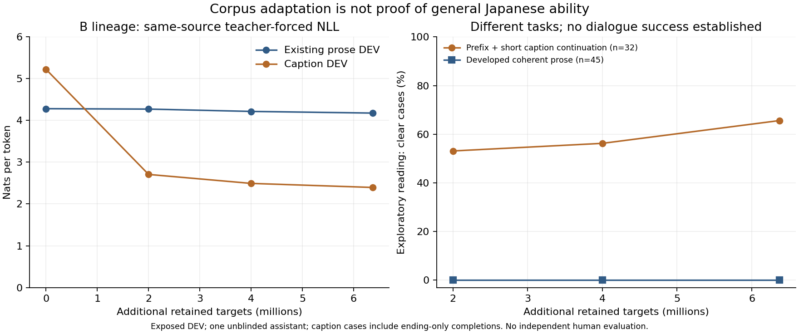

# 新規日本語原文と一巡基盤学習の実測結果

新しい人手の日本語場面説明文を研究用poolへ追加し、A/B共通比較とBの一巡学習を完了した。**短い書き出しの補完には限定的な改善が見られたが、意味を展開する段落と内容のある対話は未達。正式採用・公開置換はNo-Go。** NLL、EOS、captionの成績だけでPhase1達成とは判断しない。

サブエージェント、外部学習済み重み・Tokenizer、外部生成API、有料資源、封印TESTを使用していない。R25/R46、公開モデル・サイト、旧厳格ゲート、Git履歴を保持し、PRをマージしない。Draft PRは #105。

## 1. 実際に確保・使用した原文

|量の種類|実数|意味と制限|
|---|---:|---|
|STAIR公式raw TRAIN取得|413,915 captions / 82,783画像ID / 7,196,258本文tokens|公式固定版の原文。画像、配布済みtokenized版、公式validation本文は使わない。|
|STAIR研究利用可能pool|322,483文 / 5,653,757本文tokens|機械検査・標本読解・重複/DEV検査後。全件の独立人間審査ではない。|
|今回選択した新規原文|170,787文 / 2,999,999本文tokens|82,584画像families。同画像の別説明を独立した意味や著者として数えない。|
|既存pool再利用|4,518,175本文位置|PR104の資料。新規取得へ加算しない。|
|今回選択した既存本文|3,061,242位置|説明文等2,061,282＋RealPersona999,960。過去にも学習済みの原文を含む。|
|新旧研究pool合計|10,171,932本文位置|全てが意味・著者として独立した10Mtokensだとは保証しない。|
|今回の固定一巡corpus|181,127単位 / 6,061,241本文位置 / 6,372,025教師targets|新旧混合の一巡。全量が今回初めて見た原文ではない。|

STAIRは公式repoのcommit `6ac656e65d80cbe2c914d93626a1d5454e35a5d6`、READMEのCC BY4.0、作成論文の人手annotation手順を確認した。開発48件と別のTRAIN標本64件をmain assistantが読解し、後者60/64を自然な文の候補と判定した。問題4件とDEV近重複42件はTRAINから外した。これは単独assistantの標本監査であり、全件の自然さ・人間執筆性・写真との一致を保証しない。原論文の約2,100人という作成者数は、このTRAINで独立確認した話者数ではない。

画像family64をDEVへ隔離し、同画像の別captionをTRAINへ入れない。既知の旧/新DEV30 sectionsとの検査を実施したが、匿名著者の交差、画像の視覚的類似、全ての意味的近重複を除去できたとは主張しない。画像を取得せず、画像の著作権とcaptionの許諾を混同しない。原文・取得日時・version・SHA・加工理由・帰属と元ライセンスを保持する。

Global Voicesは2,676記事の出典情報を照合したが、raw候補7,023,700tokensとその内側のv3 prose候補1,312,598tokensは、引用・訳文・事実・連続文脈の懸念によりTRAIN0。大阪市29,624候補tokens、青空文庫20,775候補tokensも未採用。MAFFは新20回答を読み、12件をprose候補としたが、今回すべてsource-held-out DEVとして保護した。候補量と採用量を合算しない。[SOURCE_REPORT.md](SOURCE_REPORT.md)、[ADMISSION_STATUS.json](ADMISSION_STATUS.json)に内訳と根拠を保存した。CENSUSの「採用0」はGlobal Voicesの履歴で、別途採用したSTAIRを指さない。

## 2. 分布、Tokenizer、境界

|source|選択単位|本文tokens/位置|種類|
|---|---:|---:|---|
|STAIR|170,787|2,999,999|短い人手の場面説明。会話や理由説明ではない。|
|JaQuAD|5,152|1,681,084|既存の百科的抜粋。文書末端EOSを付けない。|
|Wikibooks|1,835|249,266|既存の説明文等。|
|Wikivoyage|831|115,436|既存の旅行説明。|
|JMA|85|15,496|既存の気象説明。|
|RealPersona|2,437会話|999,960|142匿名話者。人間A/Bをassistant役へ変更しない。|

本文の約49.5%がcaption、約34.0%が既存prose、約16.5%が人間会話である。captionは単文・具体物・現在の動作に偏り、理由、手順、複数文の展開、対話返信を補う十分な資料ではない。全新規poolの残り2,653,758本文tokensは今回処理していない。

独自BPE3997、context256を維持した。STAIR rawでは約0.829tokens/文字、base-byte token比約1.16%。後者は未知文字率そのものではない。captionは最大139tokensでcontext内に収まり、この分布の失敗をcontext256だけで説明する根拠はない。採用原文のUTF-8 byte復元を全件確認した。

教師EOS244,716、role73,268、BOS/PAD教師0、重複教師位置0。既存抜粋7,200箇所はBOSなしの最初のbody位置を文脈として保持した。`6,061,241 + 244,716 + 73,268 - 7,200 = 6,372,025`。任意のwindow末端にEOSを作らず、独立行の文書を連結しない。captionのEOSは原典のannotation単位終了であり、文書・段落生成の証拠とは別である。

全教師に占めるEOSは旧corpus3.7085%、今回3.8405%で、総頻度の差は小さい。短文の終了改善を総EOS頻度だけへ帰属しない。可変padding、Adam reset、scheduleもPR104との差に含まれるため、旧実験との差を純粋なデータ追加だけの因果比較とは呼ばない。本実験内のA/Bはこれらを共通化した。

## 3. 固定した学習と実行数

11,225,280パラメータ、8層・幅320・4heads・FFN1280の既存独自構造を使用した。A/BともPR104終端の重みを保持し、新規AdamW（β=.9/.999、eps=1e-8、decay=.05）、共通RNG、同一batch/scheduleを用いた。Bは以前に独自乱数初期化から学習した系列の続きで、今回未学習へ再初期化したものではない。Aにはさらに旧3470更新の会話履歴があり、追加targetsが同量でも累積学習量は同じではない。

LRは前回終端3e-5から1e-5への単調なcosineで、再開時に上げない。clipping1、全causal CE、EOS重み、BPE、contextは固定した。2M共通予算の後、Aに「発展したproseが2件以上多い」という事前条件の優位がなかったため、事前のB優先規則に従った。Aの低いNLLだけでは採用しなかった。Bの能力的優越が実証されたという選択ではない。

|checkpoint|保持更新|保持targets|実optimizer呼出し|worker保存累計秒|
|---|---:|---:|---:|---:|
|A比較終端|1,997|2,000,891|1,999|1,250.68|
|B比較終端|1,997|2,000,891|1,999|1,276.51|
|B中間|3,994|4,000,227|3,996|2,555.63|
|B一巡終端|6,361|6,372,025|6,363|4,076.75|

Bの各行は累計で、合算しない。**全体は保持8,358更新、実呼出し8,362回、再開検証4回、recovery replay0回。保持8,372,916targets、物理処理8,376,970targets。** 検証4回も実際に計算したものとして記録した。曖昧な未完了intent、隠した無効optimizer更新はない。取得・評価・別process再開検証等は表のworker保存累計時間と別で、全作業のwall timeではない。

CPU2・RAM8GiB・GPUなし。終端最大RSS2,054,364KiB（約1.96GiB）。B保持更新の勾配norm平均2.2929、最大18.5334、clipping6,361/6,361、全て有限。これだけでclippingが原因とは断定しない。[GRADIENT_CALL_AUDIT.json](next-foundation/GRADIENT_CALL_AUDIT.json)、[LOSS_HISTORY.csv](next-foundation/LOSS_HISTORY.csv)にloss・LR・source・勾配を保存した。

## 4. NLLと生成全文

全語彙greedy、固定prefix、最大128tokensの主要原文評価を変更しなかった。出力全文、全token列、raw bytes、停止理由、checkpoint対応は[evaluation/](next-foundation/evaluation/)と[panels/](next-foundation/panels/)に無修正で保存した。旧評価を上書きしていない。

|Bの固定DEV NLL|開始|約2Mtargets|約4Mtargets|6.372Mtargets|
|---|---:|---:|---:|---:|
|既存prose（42,125targets）|4.2814|4.2720|4.2161|4.1763|
|別family9（2,427targets）|4.1898|4.1536|4.1000|4.0648|
|caption（4,704targets）|5.2239|2.7074|2.4928|2.3957|
|JMA（3,300targets）|4.5475|4.5525|4.4699|4.4517|
|MAFF（2,016targets）|4.3839|4.4563|4.3937|4.3777|

|B生成診断（EOS / repeat4件数）|開始|約2M|約4M|終端|
|---|---:|---:|---:|---:|
|旧24|1 / 23|3 / 21|3 / 21|3 / 21|
|新caption32|2 / 30|32 / 0|32 / 0|32 / 0|
|JMA12|2 / 10|10 / 2|8 / 6|7 / 6|
|MAFF12|1 / 11|12 / 0|11 / 1|12 / 0|

repeat4は機械指標で、有害性の判断は別に行う。旧24の21例は全文の有害反復を確認した。JMAは開始より改善した一方、2M時点から終端では反復2/12→6/12へ退行した。NLL改善と生成悪化が同時に起きており、隠さない。

**発展した意味の通るproseは、旧24・別family9・MAFF12の計45件で、共通比較・中間・終端とも0/45。** 旧24の1件は与えられた「発展して」を「います。」で閉じるだけで、段落生成と同一視しない。

captionは「与えたprefix＋生成した短い続き」の自然さを別に読解した。A比較16/32、B比較17/32、B中間18/32、B終端21/32を明確な短文候補とした。終端は他に保留4、失敗7で、候補21件中4件は主に語尾等の補完である。写真との一致や参照文の完全一致を求める課題ではない。これは単独・非盲検assistantの判定で、独立母語話者評価、自然な段落、内容応答の合格ではない。

入力prefixと生成部分の例（各生成部分を無修正で記載）：

|入力prefix|終端の生成部分|判定の範囲|
|---|---|---|
|木の下にシマウマ|が立っている|自然な短い補完。|
|子供がフリスビーを|持って立っている|自然な短い補完。|
|木の台の上に、スー|ツケースが置いてある|部分語の補完改善。|
|タッパーの中にニ|ーボードが置いてある|擬似単語。|
|鹿児島県のシラス台地でサ|ーフィンをしている|説明文への不適切なscene-pattern混入。|
|小麦はどこの国から輸入されているの|を見ている|文脈・構文が不成立。|

## 5. 内容応答、一般化、履歴誤差

終端の内容必須24、資料付き23、限定36、入力条件反転12は、自然な全文と必要内容を両立する合格0。native24の就業状況1件は「お仕事はお仕事をしています」と就業の意図をうかがわせるが、不自然な重複があり部分的・不確実として残した。無かったことにも、自然な合格にもしていない。

自己履歴4エピソードは成功0。実際のturn数は `[1,1,1,3]` で、3件は既定の文脈予算で途中に止まり、4件全部3turnを実行したとは記録しない。1件の3turnも意味が成立しない。長く無関係な返答を出してからcontextを増やすだけでは、応答能力を改善したことにならない。

TRAINのcaption4/prose4の固定probeも、原文全体の暗記やTRAIN全体への適合を証明しない。一方、PR104で識別可能なprefixを持つ3原文・独立335本文tokensを64更新/21,632targetsで末尾まで再現した診断は再利用した。新しい本学習にその診断重みを混ぜず、同じ暗記実験を再実行しなかった。

9原文family・567targetsの履歴入替え診断では、終端で正しい履歴のNLLが無関係履歴より9/9件低く、平均差-0.1044natsだった。これは原文の予測に対する小さな文脈依存であり、質問に意味的に答える証拠ではない。

保存済み出力の**事後的なforensic再生**では、旧24とcaption32の両モデル共通922位置を固定し、EOS後は再生しなかった。新規評価で選択し直さず、追加更新0。自己履歴からのargmaxは保存済み生成と全1,844位置で一致した。

|旧24の共通688位置|開始B|終端B|
|---|---:|---:|
|正解履歴での参照token NLL|4.1987|4.1076|
|実際の自己履歴での同token NLL|7.9118|8.3404|

正解履歴でも予測は十分でなく、自分の履歴でさらに悪化する。短文ではteacher NLL4.7063→2.2156、自己履歴NLL7.7634→6.9650だった。ただし参照文以外にも正しい続きがあるため、参照差を意味失敗と同一視しない。共通位置での自己履歴EOS確率平均は終端で旧prose約0.188%、caption約11.43%。反復4-gram完成位置の中央値は旧proseで0始まり13→16で、意味崩壊の開始位置そのものではない。確率、entropy、数字/空白piece質量、全位置を[HISTORY_REPLAY.json](next-foundation/HISTORY_REPLAY.json)へ保存した。

事前固定した補助8件では、原文の名詞を語末まで与えると擬似単語が出ず、各checkpointで短文7/8を候補、1/8を副詞との結合が不確実として保留にした。入力情報・位置も変わるので、Tokenizerだけの原因証明ではない。主要32件の採点やcheckpoint選択を変更していない。

## 6. 実証範囲と次の判断

- 短い文の形・終了と一部の語彙的条件依存は学べる。caption sourceの未学習画像familyへの限定的な補完が見られたが、著者独立・意味的新規性・他ジャンルへの一般化は未保証。
- 正解履歴での予測不足と自己履歴による増幅が併存する。NLL低下だけ、EOS不足だけ、clippingだけ、JSの丸めだけに原因を単純化できない。
- 自由生成の主要評価はraw Pythonでも崩れる。限定JS照合の合格と過去の暗記診断は重大な実装不整合を支持しないが、全不具合を否定する証明ではない。
- 説明・理由・手順・複数文が不足し、captionが約半分を占める。データの量と分布、目的、学習量が引き続き主要候補である。Bのこの系列の累積はPR104と今回で11,243,673targetsであり、少量学習だけから11Mの容量不足を断定しない。
- context到達前に崩れる例が多く、context256だけで説明しない。BPEのbyte復元は正しいが、語彙/部分語学習の問題は残り得る。より大きいBPE・context・モデル幅・LRは別条件として検証する。

次は新しい現代日本語のつながった段落を優先し、captionや少数QAの周回へ戻らない。データが揃えば11M対約27Mを独立比較するが、0更新probeを大型モデルの言語能力や学習速度の証拠にしない。[NEXT_STRATEGY.md](NEXT_STRATEGY.md)にデータ、容量、Tokenizer、context、CPU/GPU/保存資源の条件付き計画を保存した。段落未達のため応答追加学習は実施しなかった。

## 7. checkpoint・再現性・評価の限界

A1997、B1997、B3994、B6361の全状態を32MiB以下のlossless chunksとしてremote Gitへ保存した。全chunk/全体SHAと、Git-only復元したmodel・Adam・Torch/private/globalPython/NumPy RNG・sampler・cursor・traceの一致を確認した。復元確認後だけ作業chunkやrawの重複コピーを整理した。正式checkpointやGit履歴を削除していない。

全44固定入力SHA、末尾model/Adamの有限性、Adam step6361、model累計更新12820、状態integrityを確認した。A/Bの実更新後2→4完全再開、共通1997更新の全batch形状・targets・LRと終端RNG/sampler一致も確認済み。初回の保持4-update stateはrollingで置換する方針であり、全128更新世代を永久保持したとは主張しない。

終端の限定Python/JS照合は12位置、最大logit差5.722e-6、許容2e-4、argmax不一致0、短い独立生成の分岐0。長文、丸めexport、別hardwareの完全一致や、過去の既知の数値分岐の解消を証明しない。

ローカル21テスト、公開メタデータ、全採用unitのbyte/境界/教師位置検証が合格した。既存の静的サイト検査も中間commitまでsuccessを確認しており、終端成果物の最新CIはPR checksへ対応commit付きで記録する。検査範囲を減らしたり、既存公開コードを変えて通してはいない。

盲検用914件の無修正出力資料を準備したが、人間評価者・ratingは0。出力は既に公開研究DEVで、真の未見TESTや独立母語話者評価へ改名しない。main assistantは既にモデル条件を知っている。資料作成を独立評価完了と扱わない。

[CHECKPOINT_INDEX.json](next-foundation/CHECKPOINT_INDEX.json)、[FINAL_VERIFY.json](next-foundation/FINAL_VERIFY.json)、[RESULTS.json](next-foundation/RESULTS.json)、[REPRODUCE.md](next-foundation/REPRODUCE.md)が復旧・照合の入口である。データ処理の初期BOS assertionやsource HTTP停止、cleanup時のremote参照確認失敗も各failure/receiptへ保持し、optimizer更新の失敗と混同しない。

## 8. Go / No-Go

**固定した研究用一巡学習は実行・評価完了。正式採用、公開置換、Phase1合格、追加epoch、内容応答追加学習はNo-Go。** 実際の前進は、新規の許諾付き原文を確保し、短い補完の改善と、段落・対話へ転移しない範囲を実測できたことである。次の優先課題は、長く意味がつながる原文の多様化と十分な学習、その後の独立した容量・Tokenizer・最適化の比較である。
